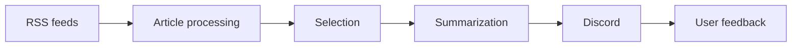

# CyberWatch

CyberWatch is a Python Discord bot that collects, filters, summarizes and publishes cybersecurity news.

The project is designed as a small automated news pipeline and as a portfolio project focused on Python, automation and cybersecurity.

## Features

* RSS feed collection
* Article filtering and categorization
* Content enrichment and CVE information
* Publication selection
* Automatic summaries
* Discord publishing
* Publication state and duplicate prevention
* User feedback
* Automated tests
* Hourly runs on GitHub Actions, no server needed
* Docker deployment
* CI with GitHub Actions

## Architecture



The bot periodically processes articles through this pipeline and publishes only articles that pass the configured rules.

For the detailed architecture and responsibilities of each component, see [`docs/ARCHITECTURE.md`](docs/ARCHITECTURE.md).

## Quick start

### Local

```bash
git clone https://github.com/Gemukii/CyberWatch.git
cd CyberWatch

python -m venv .venv
.venv\Scripts\activate

pip install -r requirements.txt
python bot.py
```

For development and testing dependencies:

```bash
pip install -r requirements-dev.txt
```

To run a single cycle without posting anything to Discord:

```bash
python run_once.py --dry-run
```

### Docker

```bash
docker compose up --build
```

Configuration is provided through environment variables and YAML configuration files.

## Deployment without a server

GitHub Actions runs one cycle an hour, and the bot only exists for the length of that run. See [ADR-001](docs/adr/001-serverless-hosting.md) for why.

1. In the repository settings, under **Secrets and variables > Actions**, add the secrets `DISCORD_TOKEN`, `DISCORD_CHANNEL_ID` and `GEMINI_API_KEY`.
2. Merge to `main`. Scheduled workflows only run from the default branch.
3. Under **Actions > watch > Run workflow**, keep `dry_run` ticked and start a run. It checks the token and history access without posting.
4. From then on, the schedule takes over.

GitHub disables scheduled workflows after 60 days without repository activity. If the digest stops arriving, re-enable `watch` from the **Actions** tab.

In this mode the bot appears offline and slash commands aren't available. They need `bot.py` running on a server.

## Project structure

```text
CyberWatch/
├── bot.py          # resident bot with slash commands
├── run_once.py     # one cycle, for a scheduler
├── pipeline.py     # the cycle both of them run
├── config.py
├── sources.py
├── filters.py
├── categories.py
├── enrichment.py
├── cve_service.py
├── selection.py
├── summarizer.py
├── publisher.py
├── feedback.py
├── state.py
│
├── feeds.yaml
├── tests/
├── docs/
│   ├── ARCHITECTURE.md
│   └── adr/
│
├── Dockerfile
├── docker-compose.yml
```

## Commands

When running `bot.py`, the bot exposes Discord slash commands for interacting with the running application.

See the source code for the currently available commands.

## Documentation

| Document                               | Purpose                                          |
| -------------------------------------- | ------------------------------------------------ |
| [`Architecture`](docs/ARCHITECTURE.md) | Components, responsibilities and execution flows |

## Tests

Run the test suite with:

```bash
pytest
```

The test suite covers article processing, publication state across runs, summary validation, and `run_once.py` against a local stand-in for the Discord API.

## Project status

Current development version: **v1.1**

CyberWatch is an evolving portfolio project. Its architecture and filtering pipeline may change as new features are added.
