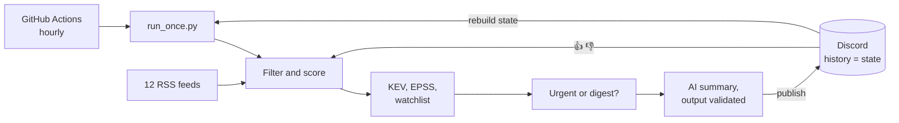

# CyberWatch

[](https://github.com/Gemukii/CyberWatch/actions/workflows/tests.yml)
[](LICENSE)

A cybersecurity watch that posts 2 to 4 articles a day to Discord, instead of everything its sources publish. It reads 12 sources every hour, ranks what it finds by confirmed exploitation, and alerts you at once when something you run is under attack.

It runs on GitHub Actions, with no server and no database.

## Why it exists

Security news has a volume problem: most of it doesn't apply to you, and the part that does is easy to miss. CyberWatch ranks articles on facts rather than headlines:

* **CISA KEV:** is this vulnerability confirmed as exploited?
* **EPSS:** how likely is it to be exploited in the next 30 days?
* **Your watchlist:** does it touch a product you run?

As an example, one run on 5 November 2026 read 40 recent articles, kept the 15 best for analysis, and raised 2 immediate alerts.

## Features

* **Daily digest:** the best articles of the day, capped by a daily quota
* **Immediate alerts:** for CVEs in KEV, very high EPSS, or reported exploitation of a product on your watchlist
* **Late escalation:** when a CVE already covered enters KEV, a new alert links back to the article
* **AI summaries:** threat, impact, target and action, with Gemini, a local Ollama model, or no AI
* **Learning from votes:** 👍 and 👎 reactions adjust the ranking, within limits
* **Prompt-injection defenses:** article text is treated as hostile, see [`docs/SECURITY.md`](docs/SECURITY.md)

## Architecture



Each run starts from nothing. It rebuilds its state from the Discord channel's history, runs one cycle over REST, then exits.

Three decisions shape the project:

* **Discord is the only storage.** There is no database to host, and the published messages are the record of what was published.
* **It fails closed.** If the history can't be read, the run publishes nothing rather than posting everything again.
* **The model has no power.** It only returns text, and that text is validated before it reaches Discord.

Read more in [`docs/ARCHITECTURE.md`](docs/ARCHITECTURE.md), [ADR-001](docs/adr/001-serverless-hosting.md) and [ADR-002](docs/adr/002-project-architecture.md).

## Quick start

### Local

```bash
git clone https://github.com/Gemukii/CyberWatch.git
cd CyberWatch

python -m venv .venv
.venv\Scripts\activate

pip install -r requirements.txt
```

To try it with no Discord account and no AI key:

```bash
AI_PROVIDER=none python run_once.py --offline
```

To run the resident bot, copy `.env.example` to `.env`, fill it in, then:

```bash
python bot.py
```

| Command | What it does |
| --- | --- |
| `python run_once.py` | One real cycle |
| `python run_once.py --dry-run` | Reads Discord and posts nothing. Fails if the token is missing |
| `python run_once.py --offline` | Skips Discord entirely |
| `python run_once.py --force-digest` | Sends the digest now |

### Docker

```bash
docker compose up --build
```

## Deployment without a server

GitHub Actions runs one cycle an hour, and the bot only exists for the length of that run.

1. In the repository settings, under **Secrets and variables > Actions**, add the secrets `DISCORD_TOKEN`, `DISCORD_CHANNEL_ID` and `GEMINI_API_KEY`.
2. Merge to `main`. Scheduled workflows only run from the default branch.
3. Under **Actions > watch > Run workflow**, keep `dry_run` ticked and start a run. It checks the token and history access without posting.
4. Start another run with `dry_run` unticked to publish for real. From then on, the schedule takes over.

Each run's page shows what it did: articles fetched, published and deferred, and failed feeds.

In this mode the bot appears offline and slash commands aren't available. They need `bot.py` running on a server.

GitHub disables scheduled workflows after 60 days without repository activity. If the digest stops arriving, re-enable `watch` from the **Actions** tab.

### Watch your own products

Add a secret named `WATCHLIST`, with your products and vendors separated by commas:

```text
fortinet,wordpress,microsoft exchange
```

Matching articles rank higher and show a 🎯 field, and reported exploitation of one of them becomes an immediate alert. It's a secret because this repository is public, and the list says what you run.

### Reliable hourly runs

GitHub skips scheduled runs under load: this project's first day got 2 runs out of about 17. An external scheduler fixes that, and GitHub's schedule stays as a fallback.

1. Create a [fine-grained token](https://github.com/settings/personal-access-tokens/new) limited to this repository, with **Actions: Read and write** only and an expiry date. It can start workflows, but can't change the code or read secrets.
2. In a scheduler such as [cron-job.org](https://cron-job.org), add an hourly job:

```text
POST https://api.github.com/repos/Gemukii/CyberWatch/actions/workflows/watch.yml/dispatches
Authorization: Bearer <token>
Accept: application/vnd.github+json
Content-Type: application/json

{"ref": "main", "inputs": {"dry_run": "false"}}
```

Keep `dry_run` set to `false`, because its default is `true`. Two overlapping triggers are safe: runs are queued, and each one reads what the last one published.

## Project structure

```text
CyberWatch/
├── bot.py          # resident bot with slash commands
├── run_once.py     # one cycle, for a scheduler
├── pipeline.py     # the cycle both of them run
├── config.py
├── sources.py
├── filters.py
├── categories.py
├── enrichment.py
├── cve_service.py
├── selection.py
├── summarizer.py
├── publisher.py
├── feedback.py
├── state.py
│
├── feeds.yaml
├── tests/
├── docs/
│   ├── ARCHITECTURE.md
│   ├── SECURITY.md
│   └── adr/
│
├── Dockerfile
├── docker-compose.yml
```

## Commands

When running `bot.py`, the bot exposes Discord slash commands for interacting with the running application.

See the source code for the currently available commands.

## Documentation

| Document                               | Purpose                                          |
| -------------------------------------- | ------------------------------------------------ |
| [`Architecture`](docs/ARCHITECTURE.md) | Components, responsibilities and execution flows |
| [`Security`](docs/SECURITY.md)         | Threat model, controls and known limits          |
| [`ADR-001`](docs/adr/001-serverless-hosting.md) | Why it runs without a server            |
| [`ADR-002`](docs/adr/002-project-architecture.md) | Why the project is built the way it is  |

## Tests

Run the test suite with:

```bash
pytest
```

The tests cover article processing, publication state across runs, summary validation and injection defenses, and `run_once.py` against a local stand-in for the Discord API.

## Project status

Current development version: **v1.1**

CyberWatch is an evolving portfolio project. Its architecture and filtering pipeline may change as new features are added.
